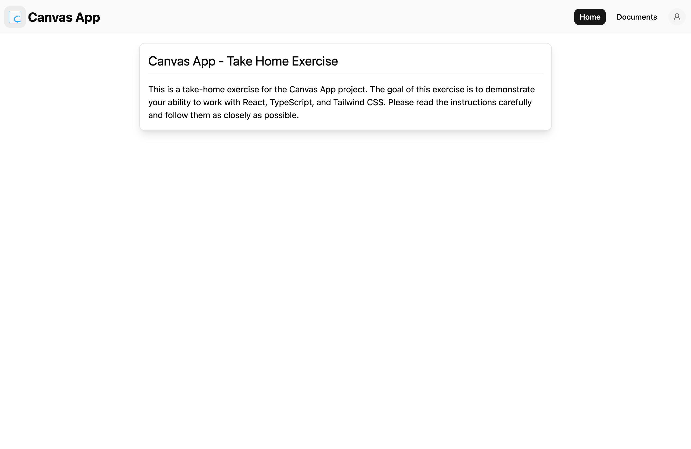
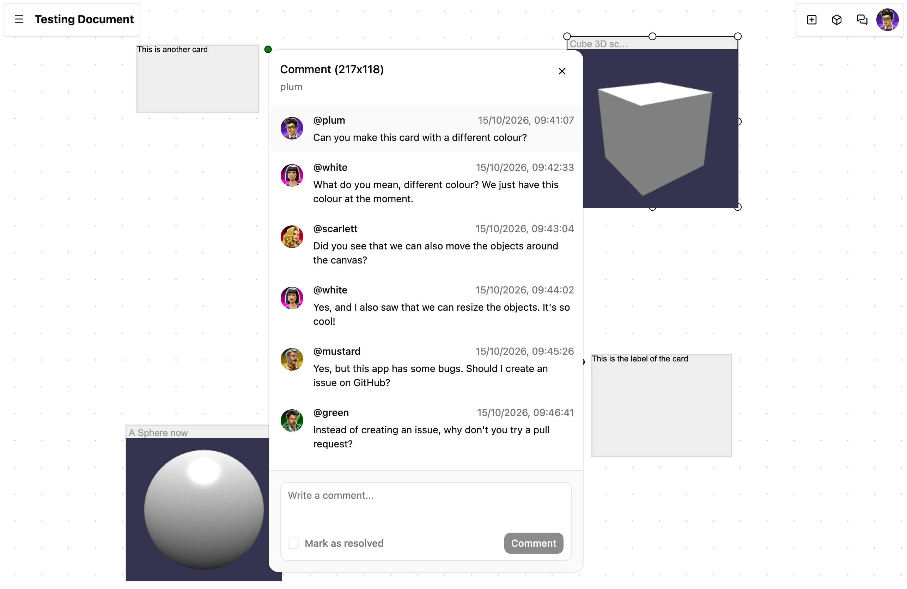
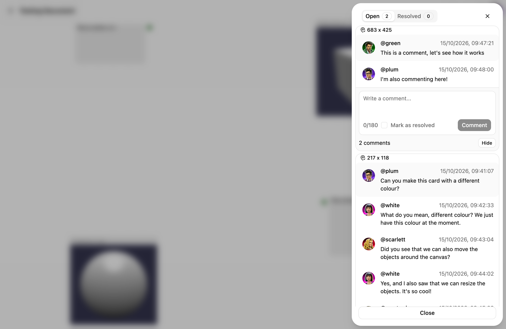
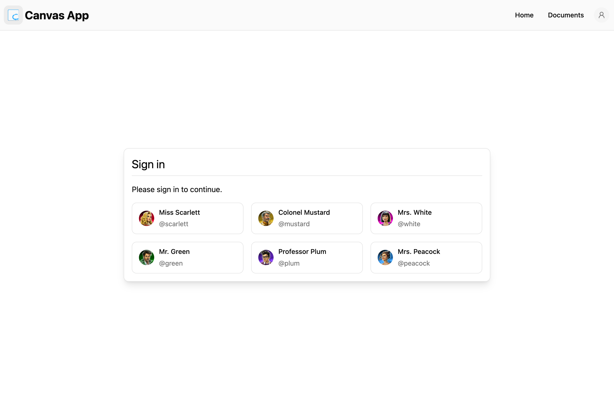

# Canvas App

An infinite Canvas App for creating and sharing ideas, notes and 3D models.

> [!NOTE]
> This project is being developed as a Take-Home Assignment for the a
> Frontend Software Engineer job position. The main goal is to demonstrate
> some of my skills and knowledge in frontend development.

## Features

- Infinite canvas for card-based objects, including embedded 3D models
- Comments and collaboration on cards

### Live Demo

You can access this Canvas App at [https://canvas.phinpho.me](https://canvas.phinpho.me).

### Screenshots

<picture>
  <source media="(prefers-color-scheme: dark)" srcset="./public/docs/home-screenshot-1-dark.png">
  <source media="(prefers-color-scheme: light)" srcset="./public/docs/home-screenshot-1-light.png">
  
</picture>

The Canvas App home screen

<picture>
  <source media="(prefers-color-scheme: dark)" srcset="./public/docs/document-screenshot-1-dark.png">
  <source media="(prefers-color-scheme: light)" srcset="./public/docs/document-screenshot-1-light.png">
  
</picture>

The Canvas App with some objects and comments.

<picture>
  <source media="(prefers-color-scheme: dark)" srcset="./public/docs/document-screenshot-2-dark.png">
  <source media="(prefers-color-scheme: light)" srcset="./public/docs/document-screenshot-2-light.png">
  
</picture>

The Canvas App with the comment panel opened.

<picture>
  <source media="(prefers-color-scheme: dark)" srcset="./public/docs/login-screenshot-1-dark.png">
  <source media="(prefers-color-scheme: light)" srcset="./public/docs/login-screenshot-1-light.png">
  
</picture>

The Canvas App login screen (with samples).

## Development Instructions

### Requirements

- Node.js (v14 or later)
- pnpm (v12.6.0 or later)

### Installation

1. Clone the repository:
   ```bash
   git clone https://github.com/phinpho/canvas-app.git
   ```
2. Navigate to the project directory:
   ```bash
   cd canvas-app
   ```
3. Install dependencies using pnpm:
   ```bash
   pnpm install
   ```

### Running the Application (Development Mode)

1. Start the development server:
   ```bash
   pnpm dev
   ```
2. Open your browser and navigate to `http://localhost:5173/` to view the application.
   > If the port `5173` is already in use, the development server will automatically
   > select a next available port, normally incremented by `1`. You can check the
   > terminal output to see the actual port being used:
   >
   > ```text
   > $ vite dev
   >
   >   VITE v8.3.1  ready in 2163 ms
   >
   >   ➜  Local:   http://localhost:5173/
   >   ➜  Network: use --host to expose
   >   ➜  press h + enter to show help
   > ```
3. To stop the development server, press `Ctrl + C` in the terminal.

### Building the Application (Production Mode)

1. Build the application for production:
   ```bash
   pnpm build
   ```
2. The production-ready files will be generated in the `dist` directory.
3. You can serve the production build using a static file server. For example, you can use `serve`:
   ```bash
   pnpm dlx serve -s dist
   ```
   > The command above will not install the `serve` package. It downloads and runs it directly
   > using `pnpm dlx`. If you want to install it globally, you can run:
   >
   > ```bash
   > pnpm install -g serve
   > ```

## Project Structure

More information about the project structure, including the architecture and design decisions are
available in the [DECISIONS.md](./DECISIONS.md) file.
